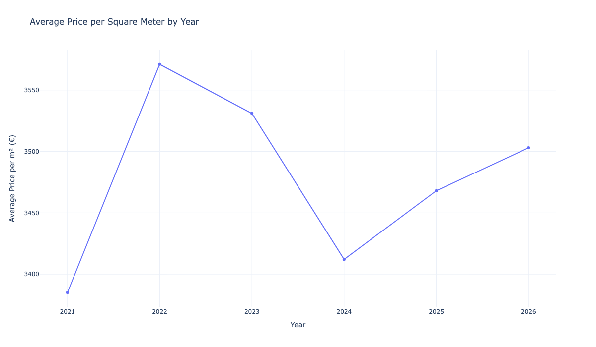
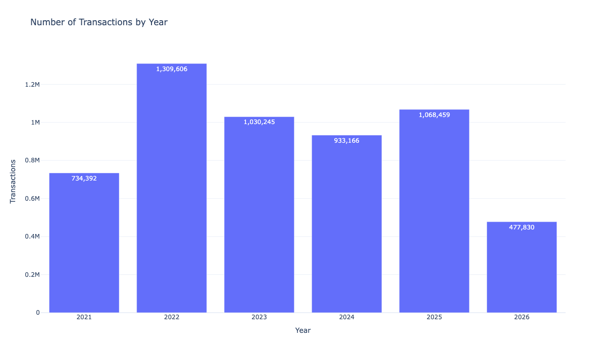
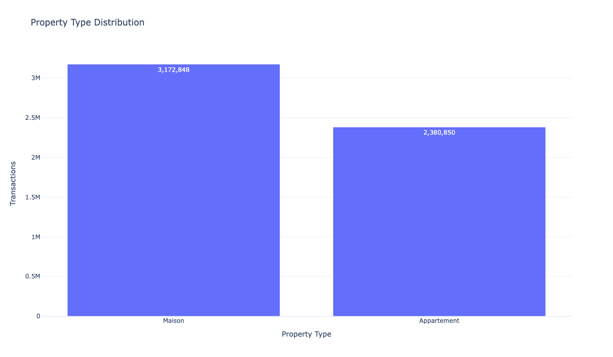
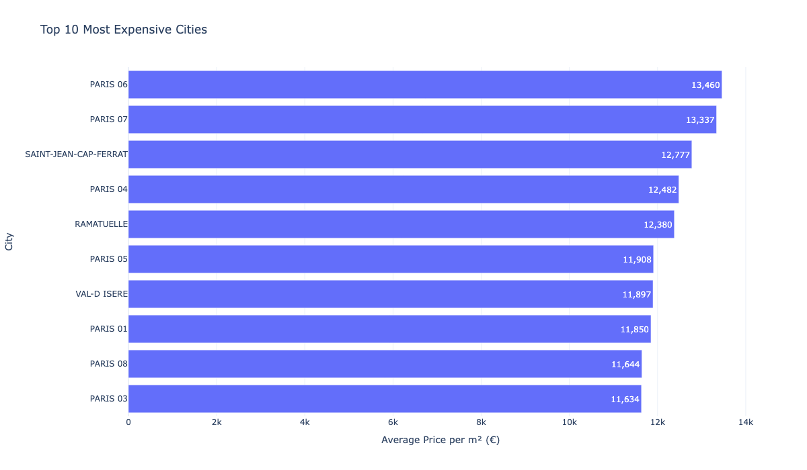
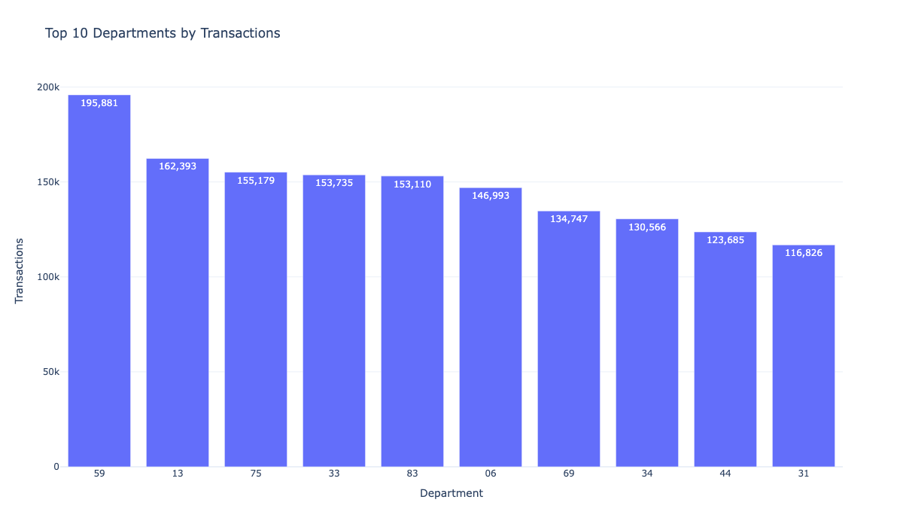
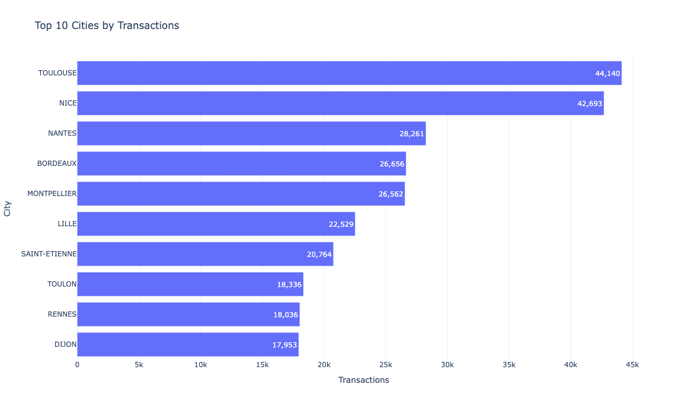

# France Real Estate Analytics

## Overview

France Real Estate Analytics is a data analytics project that explores residential real estate transactions in France using the official DVF (Demandes de Valeurs Foncières) dataset.

The objective is to analyze housing market trends, property prices, transaction volumes, and regional differences between 2021 and 2026.

The project covers more than 5.5 million residential transactions after cleaning and preprocessing over 20 million raw records from the DVF database.

## Data Source

This project uses data from the **DVF (Demandes de Valeurs Foncières)** database, an official open-data initiative provided by the **French Public Finance Directorate (DGFiP)**.

The DVF database contains property transaction records across France, including sale prices, transaction dates, property characteristics, and geographic information.

The analysis covers the period from **2021 to 2026** and is based on more than **5.5 million real estate transactions**, offering a comprehensive view of the French housing market.

---

## Objectives

- Analyze residential real estate transactions in France
- Study real estate price evolution over time
- Calculate average and median price per square meter
- Compare houses and apartments
- Identify the most expensive cities
- Identify the most active departments
- Build an interactive Streamlit dashboard

---

## Dataset

Source: DVF (Demandes de Valeurs Foncières)

Period covered:

- 2021 (Second Semester)
- 2022
- 2023
- 2024
- 2025
- 2026 (First Semester)

### Raw Data

More than 20 million records from official French property transaction data.

### Cleaned Dataset

After data cleaning and filtering:

- 5,553,698 residential transactions
- 97 departments
- 29,106 municipalities

---

## Data Cleaning

The following cleaning rules were applied:

- Kept only standard sales transactions
- Kept only residential properties:
  - House
  - Apartment
- Removed missing values
- Removed unrealistic surface areas
- Removed extreme price-per-square-meter outliers

### Filters Applied

| Rule | Condition |
|--------|------------|
| Transaction type | Vente |
| Property type | Maison, Appartement |
| Surface area | 10 m² to 500 m² |
| Price per m² | 100 € to 20,000 € |

---

## Technologies

- Python
- Pandas
- NumPy
- PyArrow
- Plotly
- Streamlit
- Git
- GitHub

---

## Project Structure

```text
france-real-estate-analytics/
│
├── data/
│   ├── raw/
│   └── processed/
│
├── dashboard/
│   └── app.py
│
├── notebooks/
│
├── reports/
│   ├── figures/
│   └── insights.md
│
├── screenshots/
│
├── src/
│   ├── data_cleaning.py
│   ├── analysis.py
│   └── visualization.py
│
├── README.md
├── requirements.txt
└── .gitignore
```

---

## Key Metrics

### Residential Transactions

- Total Transactions: 5,553,698

### Property Prices

- Average Price per m²: €3,486
- Median Price per m²: €2,625
- Average Property Value: €257,785

### Property Distribution

- Houses: 3,172,848
- Apartments: 2,380,850

---

## Main Insights

### Most Expensive Cities

- Paris 06
- Paris 07
- Saint-Jean-Cap-Ferrat
- Paris 04
- Ramatuelle

### Most Active Cities

- Toulouse
- Nice
- Nantes
- Bordeaux
- Montpellier

### Most Active Departments

- 59 (Nord)
- 13 (Bouches-du-Rhône)
- 75 (Paris)
- 33 (Gironde)
- 83 (Var)

---

## Visualizations

### Average Price per Square Meter by Year



### Number of Transactions by Year



### Property Type Distribution



### Top 10 Most Expensive Cities



### Top 10 Departments by Transactions



### Top 10 Cities by Transactions



---

## Future Improvements

- Interactive Streamlit dashboard
- Department-level analysis
- Geographic visualizations
- Real estate market forecasting
- Interactive maps
- Advanced filtering options

---

## Author

Alpha Diallo

GitHub: https://github.com/Alpha38diallo